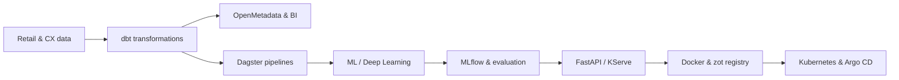

### Turning business questions and operational data into useful ML systems

## 👋 About me

I'm a **DS AI/ML Lead** working where data science, AI engineering, and retail customer experience meet. I translate business priorities into measurable ML work, guide technical decisions, and help move models from experiments into dependable services.

My background spans **retail analytics, pricing strategy, forecasting, recommendations, and customer experience platforms**. I completed my **MSc in Data Science at the Athens University of Economics and Business (AUEB) in June 2025**.

## 🔄 From data to production

I care about the complete lifecycle: reliable data, reproducible experiments, clear evaluation, simple serving contracts, and automated delivery.

## 🚀 What I work on

| | Focus | Selected experience | Explore |
|:---:|---|---|---|
| 📈 | **Forecasting** | Footfall prediction from Xovis sensor data, enriched with weather and calendar effects | [Project overview ↓](#retail-footfall-forecasting) · ⏳ **Repository coming soon** |
| 🎯 | **Personalization** | Personally implemented, context-aware retrieval and recommendation systems for retail experiences | [PoCs Recommender Clothing ↗](https://github.com/jasproudis/PoCsRecommenderClothing) · 🔒 **Public access coming soon** |
| 🧾 | **Pricing analytics** | Price elasticity, promotion analysis, and commercial decision support | [Visualization ↗](https://github.com/jasproudis/Visaulization-and-Comunication) · ⏳ **Case study coming soon** |
| 🧠 | **Applied AI** | Deep learning, multimodal classification, and Hugging Face model workflows | [Deep learning ↗](https://github.com/jasproudis/deep-learning-assignment) · [AI foundations ↗](https://github.com/jasproudis/Problem-Solving-with-Artificial-Intelligence-and-Advanced-Estimation-Algorithms) |
| 🤖 | **Agentic AI** | Stateful agent workflows and visual orchestration with LangGraph and Langflow | [Workflow overview ↓](#agentic-ai-workflows) · ⏳ **Repository coming soon** |
| 🗂️ | **Data platforms** | Transformation, orchestration, metadata management, and business intelligence | [Platform overview ↓](#data--ml-platforms) · ⏳ **Repository coming soon** |
| ⚙️ | **ML platforms** | Reproducible pipelines, experiment tracking, scalable inference, and GitOps delivery | [Platform overview ↓](#data--ml-platforms) · ⏳ **Repository coming soon** |
| 🧭 | **Technical leadership** | Connecting business priorities, system design, and measurable AI outcomes | [All repositories ↗](https://github.com/jasproudis?tab=repositories) |

## 🧰 Technology stack

### AI & Machine Learning

### Data & Analytics

### APIs, MLOps & Delivery

<strong>More tools I work with</strong>

 

**Modeling:** XGBoost, LightGBM, TensorFlow Recommenders, Transformers 
**Data:** R, MongoDB, MySQL, Microsoft SQL Server, Oracle, Spark, Hadoop 
**Visualization & BI:** Matplotlib, Seaborn, Plotly, Apache Superset, Metabase, Tableau, Power BI 
**Cloud & systems:** AWS, Azure, Windows Server 
**Exploring:** Supabase, Triton Inference Server

## 🧪 Selected work

### Retail footfall forecasting

An end-to-end ML pipeline for multi-location visitor forecasting using sensor data, weather, and calendar features—with experiment tracking, automated training, and FastAPI inference.

`Forecasting` · `Feature engineering` · `MLflow` · `FastAPI` · `Docker`

⏳ **Public repository coming soon.** A shareable version is being prepared without proprietary code or data.

### Pricing & retail analytics

Exploratory analysis and machine-learning workflows for understanding price elasticity, promotion effects, stock behavior, and the commercial signals behind customer decisions.

`Pricing strategy` · `Retail analytics` · `EDA` · `Machine learning`

⏳ **Public case study coming soon.** It will share the approach and results while keeping commercial data protected.

### Agentic AI workflows

Stateful agent workflows and human-in-the-loop applications built with LangGraph and Langflow, connecting models, tools, memory, and external services into observable processes.

`LangGraph` · `Langflow` · `Hugging Face` · `FastAPI`

⏳ **Public repository coming soon.** The profile currently describes the architecture without exposing application data or internal integrations.

### Data & ML platforms

Data transformation and orchestration with dbt and Dagster, metadata discovery with OpenMetadata, analytics through Superset and Metabase, and scalable model delivery with MLflow, KServe, zot, Kubernetes, and Argo CD.

`dbt` · `Dagster` · `OpenMetadata` · `MLflow` · `KServe` · `Argo CD`

⏳ **Public repository coming soon.** The current overview presents the platform stack while a shareable implementation is being prepared.

### Recommendations & multimodal learning

Personally implemented, context-aware clothing recommendations with TensorFlow Recommenders, plus social-media sentiment classification combining BERT text features with Inception-v3 image features.

`Retrieval systems` · `TensorFlow` · `BERT` · `Computer vision`

🔒 [**PoCs Recommender Clothing**](https://github.com/jasproudis/PoCsRecommenderClothing) is currently private; public access is coming soon.

### Graph analytics & medical imaging

Community detection and link prediction on Airbnb data with Neo4j, alongside MURA abnormality detection using CNNs, transfer learning, and EfficientNetB0.

`Neo4j` · `Graph algorithms` · `PyTorch` · `Transfer learning`

> Some work comes from applied industry projects and some from my MSc coursework. Browse my [public repositories](https://github.com/jasproudis?tab=repositories) to see what is currently available.

## 🌱 Current direction

I'm deepening my work in **ML platform architecture, scalable inference, GitOps, and stateful AI agent workflows**, while continuing to develop the leadership practices that help teams deliver valuable AI systems.

### Let's connect

If you're working on applied AI, retail intelligence, or production ML, I'd be glad to compare notes.

